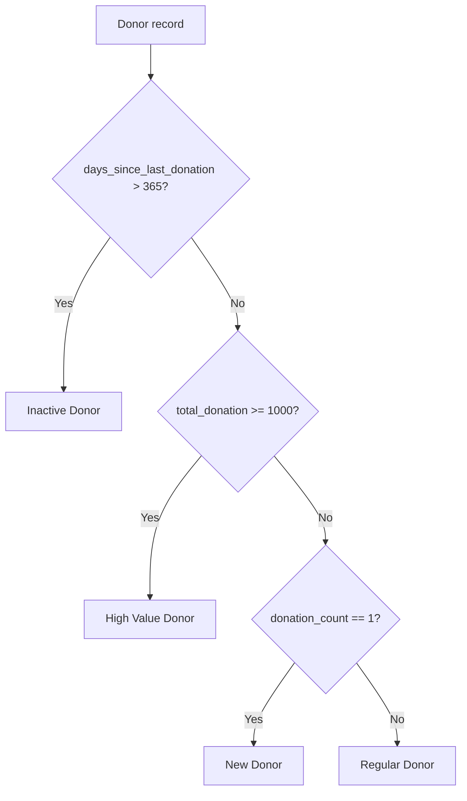
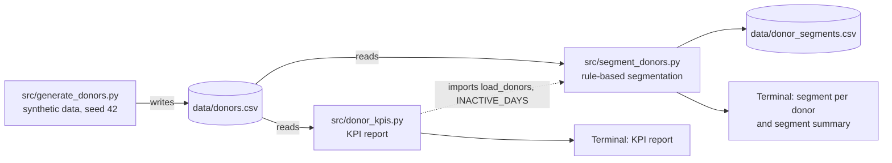

# AI Fundraising: Donor Analytics and Segmentation

A Python learning project that explores data-driven fundraising. It generates a synthetic donor dataset, produces a donor KPI report, and assigns each donor to a segment using transparent business rules. It is the first step toward a larger goal: responsible, AI-assisted fundraising intelligence.


> **Status:** Early development. The current version is a set of command-line Python scripts working on synthetic CSV data. It contains **no machine learning or AI models yet**. Those are planned and listed in the [Future Roadmap](#future-roadmap).

---

## Table of Contents

- [Overview](#overview)
- [Problem Statement](#problem-statement)
- [Project Objectives](#project-objectives)
- [Key Features](#key-features)
- [Donor Segmentation](#donor-segmentation)
- [AI and Machine Learning Approach](#ai-and-machine-learning-approach)
- [System Architecture](#system-architecture)
- [Technology Stack](#technology-stack)
- [Project Structure](#project-structure)
- [Installation and Setup](#installation-and-setup)
- [Dataset and Data Privacy](#dataset-and-data-privacy)
- [Usage Examples](#usage-examples)
- [Screenshots / Demo](#screenshots--demo)
- [Testing and Validation](#testing-and-validation)
- [Known Limitations](#known-limitations)
- [Responsible AI and Ethical Considerations](#responsible-ai-and-ethical-considerations)
- [Future Roadmap](#future-roadmap)
- [Learning Outcomes](#learning-outcomes)
- [Disclaimer](#disclaimer)
- [License and Contribution](#license-and-contribution)

---

## Overview

Fundraising teams, especially in individual giving, depend on understanding their supporters: who gives, how often, how much, and who has stopped giving. This project builds the analytics foundation for answering those questions.

**What it does today:**

- Generates a reproducible synthetic dataset of 100 donors.
- Prints a KPI report: total donors, total and average giving, the top donor, and inactive donors.
- Classifies every donor as **High Value**, **Regular**, **New**, or **Inactive** using simple, explainable rules, and saves the result to CSV.

**Who might benefit:**

- Fundraising and individual-giving analysts who want a clear starting point for donor analysis.
- Students and early-career practitioners learning how data analysis applies to the non-profit sector.
- Reviewers and interviewers looking at how the author approaches a fundraising data problem.

**Why data and AI matter in fundraising:** Donor databases are often large, and manual reporting is slow. Analytics turns raw giving history into clear signals, such as "who has lapsed" or "which small group gives most of the income." In the future, machine learning can add predictions (for example, which donors are likely to stop giving), but only on top of a reliable, well-understood data foundation. This project builds that foundation first.

---

## Problem Statement

Fundraising organizations commonly face these challenges:

| Challenge | Why it matters |
|---|---|
| **Limited understanding of donor behavior** | Without analysis, teams cannot see giving patterns such as frequency, gift size, or recency. |
| **Difficulty identifying donor segments** | Treating all donors the same leads to generic communication and missed opportunities. |
| **Donor inactivity and retention** | Keeping an existing donor is usually cheaper than finding a new one, but lapsed donors are easy to miss. |
| **Campaign performance analysis** | Teams need to know which campaigns and channels work in order to plan budgets. |
| **Manual reporting and decision-making** | Spreadsheet-based reporting is slow, error-prone, and hard to repeat. |

**How this project responds (current scope):** It addresses the first three challenges at a basic level: repeatable KPI reporting, inactive donor detection, and rule-based segmentation. Campaign performance analysis is **not** covered yet because the dataset has no campaign data. See [Planned Features](#3-planned-features).

---

## Project Objectives

1. Build a realistic but fully **synthetic** donor dataset that is safe to share.
2. Calculate core fundraising KPIs with a single, repeatable command.
3. Identify inactive (lapsed) donors and how much they have given in total.
4. Segment donors with transparent, explainable rules that a fundraiser can read and question.
5. Create a clean base for later work: exploratory analysis, churn prediction, forecasting, and responsible AI features.

---

## Key Features

### 1. Implemented Features

#### Synthetic donor data generation

- **What it does:** Creates `data/donors.csv` with 100 donors (`D001` to `D100`).
- **Why it is useful:** Allows realistic analysis without using any real or private donor data.
- **How it works** ([src/generate_donors.py](src/generate_donors.py)):
  - Uses a fixed random seed (`42`), so every run produces the same file.
  - **Number of gifts:** geometric distribution (`p=0.15`), limited to 1–30. Most donors give a few times; a few give often.
  - **Average gift size:** log-normal distribution with a typical value around $50, limited to $10–$300.
  - **Total donation:** number of gifts × average gift, rounded to the nearest $10 (minimum $10). Total giving grows with the number of gifts.
  - **Days since last donation:** exponential distribution whose scale shrinks as the number of gifts grows (`300 / √donation_count`), limited to 1–500 days. Frequent donors tend to have given more recently.
  - Donors `D001`–`D006` are overwritten with fixed reference values, so examples in this README stay stable.

#### Flexible donor data loading

- **What it does:** `load_donors()` in [src/donor_kpis.py](src/donor_kpis.py) reads donor CSV files in two formats.
- **Why it is useful:** Data exported for people (with `$` signs and text like "10 days ago") can be analyzed without manual cleaning.
- **How it works:**
  - **Raw format:** `donor_id, total_donation, donation_count, days_since_last_donation`
  - **Display format:** `Donor, Total Donation, Donations, Last Donation`, with values like `$1,000` and `10 days ago`. The loader detects the `Donor` column, removes `$` and `,` from amounts, and extracts the number of days from the text.

#### Donor KPI report

- **What it does:** Prints a summary of the donor base to the terminal.
- **Why it is useful:** Gives a quick, repeatable health check of fundraising performance.
- **How it works** ([src/donor_kpis.py](src/donor_kpis.py)):

| KPI | Definition |
|---|---|
| Total Donors | Number of rows (donors) |
| Total Donations | Sum of `total_donation`, plus the total number of gifts |
| Average Donation | Total amount ÷ number of donors, and total amount ÷ number of gifts |
| Highest Donor | Donor with the largest `total_donation` |
| Inactive Donors | Donors with `days_since_last_donation` **greater than** 365 (`INACTIVE_DAYS`), shown as a count and a percentage |

#### Inactive donor identification

- **What it does:** Lists every inactive donor, sorted by lifetime giving (highest first), and shows their combined lifetime giving.
- **Why it is useful:** Highlights which lapsed supporters were most valuable, so re-engagement efforts can be prioritized.
- **How it works:** Filters donors with no gift in more than 365 days. The report labels their combined lifetime giving as "lost value." This is historical giving, not a forecast of lost future income.

#### Rule-based donor segmentation

- **What it does:** Assigns one of four segments to every donor, prints the result, and saves `data/donor_segments.csv`.
- **Why it is useful:** Groups donors so communication can be tailored (for example, thanking high-value donors or re-engaging inactive ones).
- **How it works** ([src/segment_donors.py](src/segment_donors.py)): Uses `numpy.select` to apply ordered rules. See [Donor Segmentation](#donor-segmentation) for full details.

### 2. In Progress

| Item | Current state |
|---|---|
| Exploratory analysis notebook ([notebooks/donor_analysis.ipynb](notebooks/donor_analysis.ipynb)) | File created. It currently contains only a title cell; no analysis has been written yet. |

### 3. Planned Features

These features are **not implemented**. They are listed to show the project direction.

- At-Risk donor segment (donors whose giving is slowing down but who have not yet lapsed).
- Campaign performance analysis (requires campaign and channel data, which the dataset does not have yet).
- Donation trends over time (requires dated, per-gift transaction data).
- Exploratory data analysis with charts in the notebook.
- Machine learning models: churn prediction, clustering, donation forecasting.
- AI-generated insights and fundraising content drafts, always reviewed by a person.
- Interactive analytics dashboard.
- Automated tests.

---

## Donor Segmentation

> **Segmentation is rule-based, not machine learning.** Each donor is classified by fixed thresholds that are easy to read, explain, and change.

### Rules

Rules are checked **from top to bottom; the first rule that matches wins.**

| Order | Segment | Rule | Constant in code | Example (reference donor) |
|---|---|---|---|---|
| 1 | **Inactive Donor** | No gift in more than 365 days | `INACTIVE_DAYS = 365` | D004: $20, 1 gift, 400 days ago |
| 2 | **High Value Donor** | Lifetime giving of $1,000 or more | `HIGH_VALUE_MIN = 1000` | D005: $2,000, 20 gifts, 15 days ago |
| 3 | **New Donor** | Exactly 1 gift so far | — | D002: $50, 1 gift, 5 days ago |
| 4 | **Regular Donor** | Everyone else | — | D003: $500, 5 gifts, 200 days ago |



### Business rule notes

- **Inactivity comes first.** A donor who gave $5,000 but nothing in the last 400 days is classed as *Inactive*, not *High Value*. This puts the focus on re-engagement.
- **The threshold is inclusive.** `D001` has given exactly $1,000 and is classed as *High Value*.
- **"New" means one gift, not a recent first gift.** The dataset has no first-gift date, so a single-gift donor is "New" as long as they gave within the last 365 days.
- **Thresholds are illustrative.** $1,000 and 365 days were chosen for this synthetic dataset. They have not been calibrated against real fundraising data.

### Results on the current dataset

| Segment | Donors | Lifetime giving | Share of total giving |
|---|---:|---:|---:|
| High Value Donor | 8 | $12,170 | 33.7% |
| Regular Donor | 65 | $21,180 | 58.7% |
| New Donor | 15 | $1,070 | 3.0% |
| Inactive Donor | 12 | $1,640 | 4.5% |
| **Total** | **100** | **$36,060** | **100%** |

In this synthetic data, 8% of donors provide about a third of all giving. This kind of concentration is the reason segmentation is useful. Because the data is synthetic, these numbers show how the tool works; they are not real-world findings.

---

## AI and Machine Learning Approach

### Current state

**No AI or machine learning model is implemented yet.** All current logic is descriptive analytics and rule-based classification:

| Component | Technique | Is it ML? |
|---|---|---|
| Data generation | Random sampling from statistical distributions (NumPy) | No |
| KPI report | Sums, averages, filtering (pandas) | No |
| Segmentation | Fixed, ordered if/else rules (`numpy.select`) | No |

There are therefore no trained models, predictions, or evaluation metrics to report.

### Why start with rules

- Rules are fully transparent, which matters when decisions affect how donors are contacted.
- They provide a **baseline**. Any future ML model should be compared against these rules to show that it actually adds value.
- They work with very little data, while ML needs more history and richer features.

### Planned AI/ML capabilities

The planned machine learning and AI work is described in the [Future Roadmap](#future-roadmap).

---

## System Architecture

The project is a small, file-based pipeline of command-line Python scripts. There is no server, API, database, or user interface.



**Data flow:**

1. `generate_donors.py` creates `data/donors.csv`.
2. `donor_kpis.py` loads the donor file and prints KPIs.
3. `segment_donors.py` reuses the loader and the inactivity threshold from `donor_kpis.py`, adds a `segment` column, prints the results, and writes `data/donor_segments.csv`.

Sharing `INACTIVE_DAYS` between the two scripts ensures the KPI report and the segmentation always use the same definition of "inactive."

---

## Technology Stack

| Category | Technology | Notes |
|---|---|---|
| Language | Python 3 | Tested with Python 3.12.3 |
| Data processing | pandas, NumPy | Tested with pandas 3.1.1 and NumPy 2.5.4 |
| Notebooks | Jupyter | Listed in `requirements.txt`; the notebook is a placeholder |
| Backend | None yet | Command-line scripts only |
| Frontend | None yet | Output is printed to the terminal |
| Database | None | Data is stored in CSV files |
| AI / Machine Learning | None yet | See [Future Roadmap](#future-roadmap) |
| Infrastructure / Deployment | None | Runs locally in a Python virtual environment |
| Testing | None yet | See [Testing and Validation](#testing-and-validation) |

---

## Project Structure

```
ai-fundraising/
├── data/
│   ├── donors.csv              # 100 synthetic donors (generated)
│   └── donor_segments.csv      # donors.csv plus a segment column (generated)
├── notebooks/
│   └── donor_analysis.ipynb    # exploratory analysis (placeholder, title cell only)
├── src/
│   ├── generate_donors.py      # builds data/donors.csv
│   ├── donor_kpis.py           # loads donor data and prints the KPI report
│   └── segment_donors.py       # assigns a segment to each donor
├── .gitignore
├── requirements.txt            # pandas, numpy, jupyter
└── README.md
```

| Path | Purpose |
|---|---|
| [src/generate_donors.py](src/generate_donors.py) | Creates the synthetic dataset. Overwrites `data/donors.csv` on each run. |
| [src/donor_kpis.py](src/donor_kpis.py) | Contains `load_donors()` (shared loader), the `INACTIVE_DAYS` constant, and the KPI report. |
| [src/segment_donors.py](src/segment_donors.py) | Contains `segment()`, the `HIGH_VALUE_MIN` constant, and the segmentation report. |
| [data/](data/) | Input and output CSV files. Both files are committed so the project can be explored without running anything. |
| [notebooks/](notebooks/) | Space for exploratory analysis. |

---

## Installation and Setup

### Prerequisites

- Python 3 (tested with 3.12.3)
- `pip`
- Git

No environment variables, API keys, or database are needed.

### 1. Clone the repository

```bash
git clone https://github.com/mdabbas-cse/ai-fundraising.git
cd ai-fundraising
```

### 2. Create and activate a virtual environment

```bash
python3 -m venv venv
source venv/bin/activate        # Windows: venv\Scripts\activate
```

### 3. Install dependencies

```bash
pip install -r requirements.txt
```

### 4. Dataset setup

The dataset is already included in `data/`. To regenerate it:

```bash
python src/generate_donors.py
```

> **Important:** Run all commands from the project root. The scripts use relative paths such as `data/donors.csv`.

### 5. Run the analysis

```bash
python src/donor_kpis.py        # KPI report
python src/segment_donors.py    # segmentation; writes data/donor_segments.csv
```

### 6. Open the notebook (optional)

```bash
jupyter notebook notebooks/donor_analysis.ipynb
```

The notebook currently contains only a title cell.

---

## Dataset and Data Privacy

### Source

All data is **synthetic**. It is generated by [src/generate_donors.py](src/generate_donors.py) using NumPy random distributions. No real people, organizations, or donation records are included.

> This project uses synthetic data only. It does not use, and must never use, real UNICEF donor data or any other private donor information.

### Structure

**`data/donors.csv`**: 100 rows, one per donor.

| Column | Type | Meaning | Range in current file |
|---|---|---|---|
| `donor_id` | string | Donor ID | `D001`–`D100` |
| `total_donation` | integer | Lifetime amount given ($) | $20–$2,160 (median $200) |
| `donation_count` | integer | Number of gifts | 1–27 (median 4) |
| `days_since_last_donation` | integer | Days since the most recent gift | 2–500 (median 116.5) |

**`data/donor_segments.csv`**: the same columns plus:

| Column | Type | Meaning |
|---|---|---|
| `segment` | string | `High Value Donor`, `Regular Donor`, `New Donor`, or `Inactive Donor` |

### Preprocessing

- The raw format needs no preprocessing.
- The display format is converted by `load_donors()`: currency strings such as `$1,000` become numbers, and text such as `10 days ago` becomes `10`.
- There is currently no handling of missing values or invalid rows; input files are expected to be complete.

### Privacy by design

- The dataset has no names, emails, addresses, phone numbers, or demographic fields.
- Donor IDs are sequential labels with no link to real identities.
- Because the data is generated from a fixed seed, anyone can recreate it exactly. No data needs to be shared privately.

---

## Usage Examples

All outputs below come from running the scripts on the committed dataset.

### KPI report

```bash
python src/donor_kpis.py
```

```text
Total Donors:      100
Total Donations:   $36,060  (617 gifts)
Average Donation:  $360.60 per donor  |  $58.44 per gift
Highest Donor:     D070  $2,160  (27 gifts, last 5 days ago)
Inactive Donors:   12 of 100 (12%) with no gift in 365+ days

Inactive donors (lost value $1,640):
donor_id  total_donation  donation_count  days_since_last_donation
    D076             550               9                       372
    D018             210               5                       456
    D016             180               2                       500
    D019             160               4                       497
    D032             110               2                       500
    D043             100               1                       500
    D011              90               1                       500
    D027              80               2                       500
    D084              70               1                       500
    D041              50               1                       497
    D004              20               1                       400
    D067              20               1                       440
```

### Donor segmentation

```bash
python src/segment_donors.py
```

```text
D001 → High Value Donor
D002 → New Donor
D003 → Regular Donor
D004 → Inactive Donor
D005 → High Value Donor
D006 → Regular Donor
...

Segment summary:
  High Value Donor    8 donors  $    12,170
  Regular Donor      65 donors  $    21,180
  New Donor          15 donors  $     1,070
  Inactive Donor     12 donors  $     1,640

Saved data/donor_segments.csv
```

### Analyzing a different donor file

Both analysis scripts accept an optional file path. For example, a file in display format:

```csv
Donor,Total Donation,Donations,Last Donation
D001,"$1,000",10,10 days ago
D002,$50,1,5 days ago
D004,$20,1,400 days ago
```

```bash
python src/donor_kpis.py path/to/display.csv
```

```text
Total Donors:      3
Total Donations:   $1,070  (12 gifts)
Average Donation:  $356.67 per donor  |  $89.17 per gift
Highest Donor:     D001  $1,000  (10 gifts, last 10 days ago)
Inactive Donors:   1 of 3 (33%) with no gift in 365+ days
...
```

> **Note:** `python src/segment_donors.py path/to/file.csv` also works, but it always writes its output to `data/donor_segments.csv`, replacing the existing file.

### Exploring segments with pandas

```python
import pandas as pd

seg = pd.read_csv("data/donor_segments.csv")
high_value = seg[seg["segment"] == "High Value Donor"]
print(high_value.sort_values("total_donation", ascending=False).to_string(index=False))
```

```text
donor_id  total_donation  donation_count  days_since_last_donation          segment
    D070            2160              27                         5 High Value Donor
    D005            2000              20                        15 High Value Donor
    D081            1990              13                        48 High Value Donor
    D012            1340              22                       196 High Value Donor
    D089            1250              14                        13 High Value Donor
    D092            1250               8                       132 High Value Donor
    D044            1180              15                       189 High Value Donor
    D001            1000              10                        10 High Value Donor
```

---

## Screenshots / Demo

There are no screenshots yet. The project has no graphical interface; all output is printed to the terminal, as shown in [Usage Examples](#usage-examples).

---

## Testing and Validation

### Automated tests

**There are no automated tests yet.** Adding a `pytest` suite is the first item on the roadmap.

### Manual validation

**Reproducibility check.** The generator uses a fixed seed, so regenerating the data should produce files identical to the committed ones:

```bash
python src/generate_donors.py
python src/segment_donors.py
git diff --exit-code data/
```

No output from `git diff` means the outputs match the committed files. This check passed with Python 3.12.3, pandas 3.1.1, and NumPy 2.5.4.

**Reference donors.** Donors `D001`–`D006` have fixed values, so each segmentation rule can be checked by hand:

| Donor | Values | Expected segment | Rule tested |
|---|---|---|---|
| D001 | $1,000, 10 gifts, 10 days | High Value Donor | Inclusive $1,000 threshold |
| D002 | $50, 1 gift, 5 days | New Donor | Single gift |
| D003 | $500, 5 gifts, 200 days | Regular Donor | Default rule |
| D004 | $20, 1 gift, 400 days | Inactive Donor | Inactivity is checked before "New" |
| D005 | $2,000, 20 gifts, 15 days | High Value Donor | High lifetime giving |
| D006 | $200, 4 gifts, 30 days | Regular Donor | Default rule |

---

## Known Limitations

- No automated tests.
- `requirements.txt` does not pin versions, so a future pandas or NumPy release could change behavior.
- Scripts must be run from the project root because file paths are relative.
- The segmentation output path is fixed to `data/donor_segments.csv`.
- Thresholds are set as constants in the code and are not configurable from the command line.
- The KPI report text says "365+ days," but the rule is strictly *more than* 365 days (366 or more).
- The dataset is a single snapshot: there are no dates, individual transactions, campaigns, or channels.
- No validation of input data (missing values, negative amounts, wrong column names).

---

## Responsible AI and Ethical Considerations

Fundraising data is about real people's generosity. Even though this project uses only synthetic data today, it is designed with the following principles in mind for any future AI features.

- **Donor privacy:** Only synthetic or publicly available data is used. Real donor data, if ever used in a real organization, should stay within that organization's approved systems and policies.
- **Data protection:** Collect only what is needed. The current dataset has no personal or demographic information at all.
- **Bias mitigation:** Segments based only on gift size can undervalue loyal donors who give small amounts. Future models should be checked for unfair outcomes, especially if demographic or location data is ever added, since such fields can act as proxies for protected characteristics.
- **Transparency:** Current rules are simple and documented. Future ML models should come with explanations of which factors drive each prediction.
- **Human oversight:** Segments and future predictions are meant to *support* fundraisers, not replace them. Decisions about whom to contact, and how, should be reviewed by people.
- **Responsible use of AI-generated content:** Any future AI-written fundraising message must be reviewed by a person for accuracy, tone, and respect for the donor before use.

This project has **not** been assessed against any data protection regulation or AI standard, and it makes no compliance claims.

---

## Future Roadmap

Everything in this section is **planned and not yet implemented.** The phases build on each other.

### Phase 1: Engineering foundations

- [ ] Add a `pytest` suite for `load_donors()`, the KPI calculations, and `segment()`.
- [ ] Pin dependency versions in `requirements.txt`.
- [ ] Make file paths and thresholds configurable through command-line arguments.
- [ ] Validate input data (required columns, missing or negative values).

### Phase 2: Richer data and analytics

- [ ] Extend the synthetic dataset with dated, per-gift transactions, campaigns, and channels.
- [ ] Complete the exploratory analysis notebook with charts.
- [ ] Add an **At-Risk** segment (for example, donors with growing gaps between gifts who have not yet lapsed).
- [ ] RFM (Recency, Frequency, Monetary) scoring.
- [ ] Campaign performance analysis (income, response rate, and cost per campaign).

### Phase 3: Machine learning

- [ ] **Donor churn prediction:** a classification model (for example, logistic regression as a baseline, then tree-based models) evaluated with appropriate metrics and compared against the rule-based approach.
- [ ] **Data-driven segmentation:** clustering on RFM features, compared with the current rules.
- [ ] **Donation forecasting:** time-series forecasting of income.
- [ ] **Campaign performance prediction.**

### Phase 4: Generative AI, with human review

- [ ] Personalized fundraising message drafts for each segment, with mandatory human review.
- [ ] A RAG-based (retrieval-augmented generation) fundraising knowledge assistant that answers questions from approved documents.

### Phase 5: Governance and presentation

- [ ] Responsible AI governance: model documentation, bias checks, and a risk assessment for each AI feature.
- [ ] Interactive analytics dashboard.

---

## Learning Outcomes

**Demonstrated in the current code:**

- **Fundraising domain understanding:** donor KPIs, lapsed donors, value concentration, and segment design.
- **Donor data analysis:** aggregation, filtering, and summarizing with pandas.
- **Python and data processing:** reusable functions, shared constants across modules, and handling two input formats.
- **Synthetic data design:** choosing realistic distributions and linking variables (more gifts lead to higher totals and more recent activity).
- **Reproducibility:** fixed random seed and committed reference data.
- **Responsible data practice:** privacy-safe synthetic data and explainable rules.

**Targeted in upcoming phases:**

- AI/ML application development (churn prediction, clustering, forecasting).
- API and software architecture (services and dashboards).
- Model evaluation and responsible AI governance.

---

## Disclaimer

This is an independent learning and portfolio project created to explore AI applications in fundraising. It is not an official UNICEF product, service, or affiliated project.

All data in this repository is synthetic. Any resemblance to real donors is coincidental.

---

## License and Contribution

**License:** No license file has been added yet. Without a license, default copyright rules apply, and others are not granted permission to reuse the code.

**Contribution:** This is a personal learning project, and no contribution guidelines have been set up yet.
