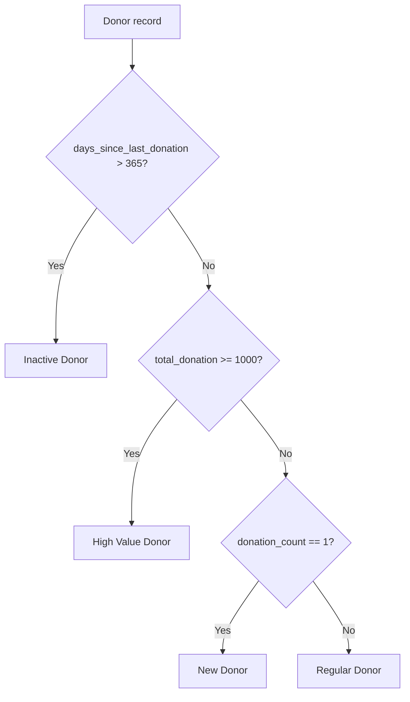
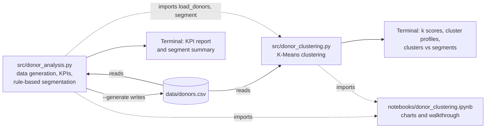

# AI Fundraising: Donor Analytics, Segmentation, and Clustering

A Python learning project that explores data-driven fundraising. It generates a synthetic donor dataset, produces a donor KPI report, assigns each donor to a segment using transparent business rules, and groups donors with K-Means clustering to compare a data-driven view with those rules. It is the first step toward a larger goal: responsible, AI-assisted fundraising intelligence.


> **Status:** Early development. The current version is two command-line Python scripts and one notebook working on synthetic CSV data. The only machine learning so far is **unsupervised K-Means clustering**; there are **no predictive models yet**. Those are planned and listed in the [Future Roadmap](#future-roadmap).

---

## Table of Contents

- [Overview](#overview)
- [Problem Statement](#problem-statement)
- [Project Objectives](#project-objectives)
- [Key Features](#key-features)
- [Donor Segmentation](#donor-segmentation)
- [AI and Machine Learning Approach](#ai-and-machine-learning-approach)
- [System Architecture](#system-architecture)
- [Technology Stack](#technology-stack)
- [Project Structure](#project-structure)
- [Installation and Setup](#installation-and-setup)
- [Dataset and Data Privacy](#dataset-and-data-privacy)
- [Usage Examples](#usage-examples)
- [Screenshots / Demo](#screenshots--demo)
- [Testing and Validation](#testing-and-validation)
- [Known Limitations](#known-limitations)
- [Responsible AI and Ethical Considerations](#responsible-ai-and-ethical-considerations)
- [Future Roadmap](#future-roadmap)
- [Learning Outcomes](#learning-outcomes)
- [Disclaimer](#disclaimer)
- [License and Contribution](#license-and-contribution)

---

## Overview

Fundraising teams, especially in individual giving, depend on understanding their supporters: who gives, how often, how much, and who has stopped giving. This project builds the analytics foundation for answering those questions.

**What it does today:**

- Generates a reproducible synthetic dataset of 100 donors.
- Prints a KPI report: total donors, total and average giving, the top donor, and inactive donors.
- Classifies every donor as **High Value**, **Regular**, **New**, or **Inactive** using simple, explainable rules, and can save the result to CSV.
- Groups donors into four clusters with **K-Means** on recency, frequency, and monetary value, and compares the clusters with the rule-based segments. A notebook walks through the method with charts.

**Who might benefit:**

- Fundraising and individual-giving analysts who want a clear starting point for donor analysis.
- Students and early-career practitioners learning how data analysis applies to the non-profit sector.
- Reviewers and interviewers looking at how the author approaches a fundraising data problem.

**Why data and AI matter in fundraising:** Donor databases are often large, and manual reporting is slow. Analytics turns raw giving history into clear signals, such as "who has lapsed" or "which small group gives most of the income." In the future, machine learning can add predictions (for example, which donors are likely to stop giving), but only on top of a reliable, well-understood data foundation. This project builds that foundation first.

---

## Problem Statement

Fundraising organizations commonly face these challenges:

| Challenge | Why it matters |
|---|---|
| **Limited understanding of donor behavior** | Without analysis, teams cannot see giving patterns such as frequency, gift size, or recency. |
| **Difficulty identifying donor segments** | Treating all donors the same leads to generic communication and missed opportunities. |
| **Donor inactivity and retention** | Keeping an existing donor is usually cheaper than finding a new one, but lapsed donors are easy to miss. |
| **Campaign performance analysis** | Teams need to know which campaigns and channels work in order to plan budgets. |
| **Manual reporting and decision-making** | Spreadsheet-based reporting is slow, error-prone, and hard to repeat. |

**How this project responds (current scope):** It addresses the first three challenges at a basic level: repeatable KPI reporting, inactive donor detection, rule-based segmentation, and data-driven clustering. Campaign performance analysis is **not** covered yet because the dataset has no campaign data. See [Planned Features](#3-planned-features).

---

## Project Objectives

1. Build a realistic but fully **synthetic** donor dataset that is safe to share.
2. Calculate core fundraising KPIs with a single, repeatable command.
3. Identify inactive (lapsed) donors and how much they have given in total.
4. Segment donors with transparent, explainable rules that a fundraiser can read and question.
5. Test the rules against a data-driven view: cluster donors and compare the clusters with the segments.
6. Create a clean base for later work: churn prediction, forecasting, and responsible AI features.

---

## Key Features

### 1. Implemented Features

#### Synthetic donor data generation

- **What it does:** Creates `data/donors.csv` with 100 donors (`D001` to `D100`).
- **Why it is useful:** Allows realistic analysis without using any real or private donor data.
- **How it works** (`generate_donors()` in [src/donor_analysis.py](src/donor_analysis.py), run with `--generate`):
  - Uses a fixed random seed (`42`), so every run produces the same file.
  - **Number of gifts:** geometric distribution (`p=0.15`), limited to 1–30. Most donors give a few times; a few give often.
  - **Average gift size:** log-normal distribution with a typical value around $50, limited to $10–$300.
  - **Total donation:** number of gifts × average gift, rounded to the nearest $10 (minimum $10). Total giving grows with the number of gifts.
  - **Days since last donation:** exponential distribution whose scale shrinks as the number of gifts grows (`300 / √donation_count`), limited to 1–500 days. Frequent donors tend to have given more recently.
  - Donors `D001`–`D006` are overwritten with fixed reference values, so examples in this README stay stable.

#### Flexible donor data loading

- **What it does:** `load_donors()` in [src/donor_analysis.py](src/donor_analysis.py) reads donor CSV files in two formats.
- **Why it is useful:** Data exported for people (with `$` signs and text like "10 days ago") can be analyzed without manual cleaning.
- **How it works:**
  - **Raw format:** `donor_id, total_donation, donation_count, days_since_last_donation`
  - **Display format:** `Donor, Total Donation, Donations, Last Donation`, with values like `$1,000` and `10 days ago`. The loader detects the `Donor` column, removes `$` and `,` from amounts, and extracts the number of days from the text.

#### Donor KPI report

- **What it does:** Prints a summary of the donor base to the terminal.
- **Why it is useful:** Gives a quick, repeatable health check of fundraising performance.
- **How it works** ([src/donor_analysis.py](src/donor_analysis.py)):

| KPI | Definition |
|---|---|
| Total Donors | Number of rows (donors) |
| Total Donations | Sum of `total_donation`, plus the total number of gifts |
| Average Donation | Total amount ÷ number of donors, and total amount ÷ number of gifts |
| Highest Donor | Donor with the largest `total_donation` |
| Inactive Donors | Donors with `days_since_last_donation` **greater than** 365 (`INACTIVE_DAYS`), shown as a count and a percentage |

#### Inactive donor identification

- **What it does:** Lists every inactive donor, sorted by lifetime giving (highest first), and shows their combined lifetime giving.
- **Why it is useful:** Highlights which lapsed supporters were most valuable, so re-engagement efforts can be prioritized.
- **How it works:** Filters donors with no gift in more than 365 days. The report labels their combined lifetime giving as "lost value." This is historical giving, not a forecast of lost future income.

#### Rule-based donor segmentation

- **What it does:** Assigns one of four segments to every donor and prints a segment summary. With `--out`, it also saves the donors with a `segment` column to a CSV file.
- **Why it is useful:** Groups donors so communication can be tailored (for example, thanking high-value donors or re-engaging inactive ones).
- **How it works** (`segment()` in [src/donor_analysis.py](src/donor_analysis.py)): Uses `numpy.select` to apply ordered rules. See [Donor Segmentation](#donor-segmentation) for full details.

#### K-Means donor clustering

- **What it does:** Groups donors into clusters by behavior, prints a profile of each cluster, and shows how the clusters overlap with the rule-based segments. With `--out`, it saves the donors with `cluster` and `segment` columns.
- **Why it is useful:** Rules reflect what fundraisers already believe. Clustering lets the data suggest groups on its own, which can confirm the rules or point to donors the rules miss.
- **How it works** ([src/donor_clustering.py](src/donor_clustering.py)): K-Means from scikit-learn on log-scaled, standardized recency, frequency, and monetary features. See [AI and Machine Learning Approach](#ai-and-machine-learning-approach) for full details.

#### Clustering notebook

- **What it does:** [notebooks/donor_clustering.ipynb](notebooks/donor_clustering.ipynb) walks through the clustering step by step: feature distributions, choosing the number of clusters, cluster profiles, and the comparison with the rules.
- **Why it is useful:** Shows the reasoning and the charts behind the command-line output.
- **How it works:** Imports the functions from `src/`, so the notebook and the scripts always use the same logic.

### 2. In Progress

Nothing is partly built at the moment. The next steps are listed under [Planned Features](#3-planned-features).

### 3. Planned Features

These features are **not implemented**. They are listed to show the project direction.

- At-Risk donor segment (donors whose giving is slowing down but who have not yet lapsed).
- Campaign performance analysis (requires campaign and channel data, which the dataset does not have yet).
- Donation trends over time (requires dated, per-gift transaction data).
- Predictive machine learning models: churn prediction and donation forecasting.
- AI-generated insights and fundraising content drafts, always reviewed by a person.
- Interactive analytics dashboard.
- Automated tests.

---

## Donor Segmentation

> **Segmentation is rule-based, not machine learning.** Each donor is classified by fixed thresholds that are easy to read, explain, and change. For the data-driven alternative, see [Donor clustering (K-Means)](#donor-clustering-k-means).

### Rules

Rules are checked **from top to bottom; the first rule that matches wins.**

| Order | Segment | Rule | Constant in code | Example (reference donor) |
|---|---|---|---|---|
| 1 | **Inactive Donor** | No gift in more than 365 days | `INACTIVE_DAYS = 365` | D004: $20, 1 gift, 400 days ago |
| 2 | **High Value Donor** | Lifetime giving of $1,000 or more | `HIGH_VALUE_MIN = 1000` | D005: $2,000, 20 gifts, 15 days ago |
| 3 | **New Donor** | Exactly 1 gift so far | — | D002: $50, 1 gift, 5 days ago |
| 4 | **Regular Donor** | Everyone else | — | D003: $500, 5 gifts, 200 days ago |



### Business rule notes

- **Inactivity comes first.** A donor who gave $5,000 but nothing in the last 400 days is classed as *Inactive*, not *High Value*. This puts the focus on re-engagement.
- **The threshold is inclusive.** `D001` has given exactly $1,000 and is classed as *High Value*.
- **"New" means one gift, not a recent first gift.** The dataset has no first-gift date, so a single-gift donor is "New" as long as they gave within the last 365 days.
- **Thresholds are illustrative.** $1,000 and 365 days were chosen for this synthetic dataset. They have not been calibrated against real fundraising data.

### Results on the current dataset

| Segment | Donors | Lifetime giving | Share of total giving |
|---|---:|---:|---:|
| High Value Donor | 8 | $12,170 | 33.7% |
| Regular Donor | 65 | $21,180 | 58.7% |
| New Donor | 15 | $1,070 | 3.0% |
| Inactive Donor | 12 | $1,640 | 4.5% |
| **Total** | **100** | **$36,060** | **100%** |

In this synthetic data, 8% of donors provide about a third of all giving. This kind of concentration is the reason segmentation is useful. Because the data is synthetic, these numbers show how the tool works; they are not real-world findings.

---

## AI and Machine Learning Approach

### Current state

The project has one machine learning component: **unsupervised K-Means clustering**. It describes groups in past behavior; it does not predict anything. There are no predictive models yet.

| Component | Technique | Is it ML? |
|---|---|---|
| Data generation | Random sampling from statistical distributions (NumPy) | No |
| KPI report | Sums, averages, filtering (pandas) | No |
| Segmentation | Fixed, ordered if/else rules (`numpy.select`) | No |
| Clustering | K-Means on RFM features (scikit-learn) | Yes, unsupervised |

### Why start with rules

- Rules are fully transparent, which matters when decisions affect how donors are contacted.
- They provide a **baseline**. Any ML model should be compared against these rules to show that it actually adds value. The clustering below is the first such comparison.
- They work with very little data, while ML needs more history and richer features.

### Donor clustering (K-Means)

**Features (RFM):**

| Feature | Column | Meaning |
|---|---|---|
| Recency | `days_since_last_donation` | Days since the most recent gift |
| Frequency | `donation_count` | Number of gifts |
| Monetary | `total_donation` | Lifetime giving |

**Preprocessing:** All three features are right-skewed. Each is log-transformed (`log1p`) so a few large donors do not dominate, then standardized (`StandardScaler`) so each feature counts equally in the distance calculation.

**Model:** `KMeans(n_clusters=4, n_init=10, random_state=42)`. Clusters are renumbered so cluster 1 has the highest median lifetime giving, which keeps the numbering stable and readable.

**Choosing k:** The script and notebook report inertia (elbow method) and silhouette score for k = 2 to 8.

| k | Inertia | Silhouette |
|---:|---:|---:|
| 2 | 157.4 | 0.392 |
| 3 | 118.6 | 0.380 |
| **4** | **90.6** | **0.348** |
| 5 | 69.2 | 0.332 |
| 6 | 58.9 | 0.301 |

There is no sharp elbow, and silhouette scores for k = 2 to 5 are close together. No k is a clear statistical winner, so k = 4 was chosen because it lines up with the four rule-based segments and makes the two approaches easy to compare. This is a judgment call, and `--k` lets you try others.

**Cluster profiles on the current dataset:**

| Cluster | Donors | Median days since last gift | Median gifts | Median lifetime giving | Share of giving | Pattern |
|---:|---:|---:|---:|---:|---:|---|
| 1 | 14 | 12 | 14 | $870 | 38% | Recent, frequent, highest giving |
| 2 | 34 | 112 | 8 | $370 | 46% | Steady givers, last gift a few months ago |
| 3 | 42 | 228 | 2 | $100 | 14% | Few gifts, drifting or lapsed |
| 4 | 10 | 16 | 2 | $85 | 3% | Recent givers with only a few small gifts |

**Compared with the rule-based segments (donor counts):**

| Cluster | High Value | Regular | New | Inactive |
|---:|---:|---:|---:|---:|
| 1 | 5 | 9 | 0 | 0 |
| 2 | 3 | 30 | 0 | 1 |
| 3 | 0 | 19 | 12 | 11 |
| 4 | 0 | 7 | 3 | 0 |

**What the comparison shows:**

- Cluster 3 contains 11 of the 12 *Inactive* donors and 12 of the 15 *New* donors. The rules call a one-gift donor "New" even if that gift was almost a year ago; the clustering groups them with the lapsing donors. For a retention campaign, that may be the more useful view.
- Cluster 1 holds five of the eight *High Value* donors plus nine *Regular* donors who give often and recently but are below the $1,000 threshold. They are natural candidates for an upgrade ask.
- Because the data is synthetic, these results show how the method works; they are not real-world findings.

### Planned AI/ML capabilities

The planned machine learning and AI work is described in the [Future Roadmap](#future-roadmap).

---

## System Architecture

The project is a small, file-based pipeline of command-line Python scripts and one notebook. There is no server, API, database, or user interface.



**Data flow:**

1. `donor_analysis.py --generate` creates `data/donors.csv`.
2. `donor_analysis.py` loads the donor file, prints the KPIs, assigns segments, and prints the segment summary. `--out` saves the segments to CSV.
3. `donor_clustering.py` reuses the loader and `segment()` from `donor_analysis.py`, clusters the donors, and prints the profiles and the comparison with the segments. `--out` saves the clusters to CSV.
4. The notebook imports the same functions and adds charts.

Keeping the loader, thresholds, and rules in one module ensures the KPI report, the segmentation, and the clustering always use the same definitions.

---

## Technology Stack

| Category | Technology | Notes |
|---|---|---|
| Language | Python 3 | Tested with Python 3.12.3 |
| Data processing | pandas, NumPy | Tested with pandas 3.1.1 and NumPy 2.5.4 |
| Machine learning | scikit-learn | K-Means, `StandardScaler`, silhouette score; tested with 1.9.1 |
| Charts | matplotlib | Used in the notebook; tested with 3.11.2 |
| Notebooks | Jupyter | Installed separately; see [Installation and Setup](#installation-and-setup) |
| Backend | None yet | Command-line scripts only |
| Frontend | None yet | Output is printed to the terminal |
| Database | None | Data is stored in CSV files |
| Predictive AI / ML | None yet | See [Future Roadmap](#future-roadmap) |
| Infrastructure / Deployment | None | Runs locally in a Python virtual environment |
| Testing | None yet | See [Testing and Validation](#testing-and-validation) |

---

## Project Structure

```
ai-fundraising/
├── data/
│   └── donors.csv                  # 100 synthetic donors (generated, committed)
├── src/
│   ├── donor_analysis.py           # data generation, loader, KPI report, segmentation
│   └── donor_clustering.py         # K-Means clustering and comparison with segments
├── notebooks/
│   └── donor_clustering.ipynb      # clustering walkthrough with charts
├── .gitignore
├── requirements.txt                # pinned versions
└── README.md
```

| Path | Purpose |
|---|---|
| [src/donor_analysis.py](src/donor_analysis.py) | `generate_donors()`, `load_donors()` (shared loader), the `INACTIVE_DAYS` and `HIGH_VALUE_MIN` constants, `segment()`, and the KPI and segment report. |
| [src/donor_clustering.py](src/donor_clustering.py) | `rfm_features()`, `score_k()`, `cluster()`, `profile()`, `compare_with_segments()`, and the clustering report. |
| [data/](data/) | The donor dataset, committed so the project can be explored without running anything. Optional `--out` files (`donor_segments.csv`, `donor_clusters.csv`) are ignored by Git. |
| [notebooks/](notebooks/) | The clustering notebook. It is committed without outputs; run it to see the tables and charts. |

---

## Installation and Setup

### Prerequisites

- Python 3 (tested with 3.12.3)
- `pip`
- Git

No environment variables, API keys, or database are needed.

### 1. Clone the repository

```bash
git clone https://github.com/mdabbas-cse/ai-fundraising.git
cd ai-fundraising
```

### 2. Create and activate a virtual environment

```bash
python3 -m venv venv
source venv/bin/activate        # Windows: venv\Scripts\activate
```

### 3. Install dependencies

```bash
pip install -r requirements.txt
```

### 4. Dataset setup

The dataset is already included in `data/`. To regenerate it:

```bash
python src/donor_analysis.py --generate
```

> **Important:** Run all commands from the project root. The scripts use relative paths such as `data/donors.csv`.

### 5. Run the analysis

```bash
python src/donor_analysis.py      # KPI report and segment summary
python src/donor_clustering.py    # K-Means clusters compared with the segments
```

Add `--out <file>.csv` to either command to save the per-donor results. Use `--help` to see all options.

### 6. Open the notebook (optional)

Jupyter is not in `requirements.txt`. Install it once, then open the notebook:

```bash
pip install jupyter
jupyter notebook notebooks/donor_clustering.ipynb
```

In VS Code, installing `ipykernel` is enough to run the notebook in the editor. The notebook finds `src/` and `data/` whether it is started from the project root or from `notebooks/`.

---

## Dataset and Data Privacy

### Source

All data is **synthetic**. It is generated by `generate_donors()` in [src/donor_analysis.py](src/donor_analysis.py) using NumPy random distributions. No real people, organizations, or donation records are included.

> This project uses synthetic data only. It does not use, and must never use, real UNICEF donor data or any other private donor information.

### Structure

**`data/donors.csv`**: 100 rows, one per donor.

| Column | Type | Meaning | Range in current file |
|---|---|---|---|
| `donor_id` | string | Donor ID | `D001`–`D100` |
| `total_donation` | integer | Lifetime amount given ($) | $20–$2,160 (median $200) |
| `donation_count` | integer | Number of gifts | 1–27 (median 4) |
| `days_since_last_donation` | integer | Days since the most recent gift | 2–500 (median 116.5) |

**Optional outputs** (written only when you pass `--out`): the same columns plus:

| Column | Written by | Type | Meaning |
|---|---|---|---|
| `segment` | both scripts | string | `High Value Donor`, `Regular Donor`, `New Donor`, or `Inactive Donor` |
| `cluster` | `donor_clustering.py` | integer | Cluster number, 1 = highest median lifetime giving |

### Preprocessing

- The raw format needs no preprocessing.
- The display format is converted by `load_donors()`: currency strings such as `$1,000` become numbers, and text such as `10 days ago` becomes `10`.
- There is currently no handling of missing values or invalid rows; input files are expected to be complete.

### Privacy by design

- The dataset has no names, emails, addresses, phone numbers, or demographic fields.
- Donor IDs are sequential labels with no link to real identities.
- Because the data is generated from a fixed seed, anyone can recreate it exactly. No data needs to be shared privately.

---

## Usage Examples

All outputs below come from running the scripts on the committed dataset.

### KPI report and segmentation

```bash
python src/donor_analysis.py --out data/donor_segments.csv
```

```text
Total Donors:      100
Total Donations:   $36,060  (617 gifts)
Average Donation:  $360.60 per donor  |  $58.44 per gift
Highest Donor:     D070  $2,160  (27 gifts, last 5 days ago)
Inactive Donors:   12 of 100 (12%) with no gift in 365+ days

Inactive donors (lost value $1,640):
donor_id  total_donation  donation_count  days_since_last_donation
    D076             550               9                       372
    D018             210               5                       456
    D016             180               2                       500
    D019             160               4                       497
    D032             110               2                       500
    D043             100               1                       500
    D011              90               1                       500
    D027              80               2                       500
    D084              70               1                       500
    D041              50               1                       497
    D004              20               1                       400
    D067              20               1                       440

Segment summary:
  High Value Donor    8 donors  $    12,170
  Regular Donor      65 donors  $    21,180
  New Donor          15 donors  $     1,070
  Inactive Donor     12 donors  $     1,640

Saved data/donor_segments.csv
```

Without `--out`, the report is the same and no file is written.

### Donor clustering

```bash
python src/donor_clustering.py
```

```text
Choosing k (lower inertia is tighter; higher silhouette is better separated):
   inertia  silhouette
k                     
2  157.397       0.392
3  118.602       0.380
4   90.605       0.348
5   69.164       0.332
6   58.897       0.301
7   52.842       0.315
8   47.193       0.282

Cluster profiles (k=4, cluster 1 = highest median giving):
         donors median_days_since_last median_gifts median_total share_of_giving
cluster                                                                         
1            14                     12           14         $870             38%
2            34                    112            8         $370             46%
3            42                    228            2         $100             14%
4            10                     16            2          $85              3%

Clusters vs rule-based segments (donor counts):
segment  High Value Donor  Regular Donor  New Donor  Inactive Donor
cluster                                                            
1                       5              9          0               0
2                       3             30          0               1
3                       0             19         12              11
4                       0              7          3               0
```

Try a different number of clusters with `--k 3`, or save the labels with `--out data/donor_clusters.csv`.

### Analyzing a different donor file

Both scripts accept an optional file path. For example, a file in display format:

```csv
Donor,Total Donation,Donations,Last Donation
D001,"$1,000",10,10 days ago
D002,$50,1,5 days ago
D004,$20,1,400 days ago
```

```bash
python src/donor_analysis.py path/to/display.csv
```

```text
Total Donors:      3
Total Donations:   $1,070  (12 gifts)
Average Donation:  $356.67 per donor  |  $89.17 per gift
Highest Donor:     D001  $1,000  (10 gifts, last 10 days ago)
Inactive Donors:   1 of 3 (33%) with no gift in 365+ days
...
```

> **Caution:** `--generate` writes the synthetic dataset to the given path. `python src/donor_analysis.py path/to/file.csv --generate` replaces that file.

### Exploring segments with pandas

After running `python src/donor_analysis.py --out data/donor_segments.csv`:

```python
import pandas as pd

seg = pd.read_csv("data/donor_segments.csv")
high_value = seg[seg["segment"] == "High Value Donor"]
print(high_value.sort_values("total_donation", ascending=False).to_string(index=False))
```

```text
donor_id  total_donation  donation_count  days_since_last_donation          segment
    D070            2160              27                         5 High Value Donor
    D005            2000              20                        15 High Value Donor
    D081            1990              13                        48 High Value Donor
    D012            1340              22                       196 High Value Donor
    D089            1250              14                        13 High Value Donor
    D092            1250               8                       132 High Value Donor
    D044            1180              15                       189 High Value Donor
    D001            1000              10                        10 High Value Donor
```

---

## Screenshots / Demo

There are no screenshots yet. The scripts print to the terminal, as shown in [Usage Examples](#usage-examples). The clustering notebook draws three charts when run: feature distributions, inertia and silhouette by k, and each cluster plotted against all other donors.

---

## Testing and Validation

### Automated tests

**There are no automated tests yet.** Adding a `pytest` suite is the first item on the roadmap.

### Manual validation

**Reproducibility check.** The generator uses a fixed seed, so regenerating the data should produce a file identical to the committed one:

```bash
python src/donor_analysis.py --generate
git diff --exit-code data/
```

No output from `git diff` means the data matches the committed file. This check passed with Python 3.12.3, pandas 3.1.1, and NumPy 2.5.4. K-Means also uses a fixed seed (`random_state=42`), so the clustering output is repeatable.

**Reference donors.** Donors `D001`–`D006` have fixed values, so each segmentation rule can be checked by hand:

| Donor | Values | Expected segment | Rule tested |
|---|---|---|---|
| D001 | $1,000, 10 gifts, 10 days | High Value Donor | Inclusive $1,000 threshold |
| D002 | $50, 1 gift, 5 days | New Donor | Single gift |
| D003 | $500, 5 gifts, 200 days | Regular Donor | Default rule |
| D004 | $20, 1 gift, 400 days | Inactive Donor | Inactivity is checked before "New" |
| D005 | $2,000, 20 gifts, 15 days | High Value Donor | High lifetime giving |
| D006 | $200, 4 gifts, 30 days | Regular Donor | Default rule |

---

## Known Limitations

- No automated tests.
- Jupyter is not listed in `requirements.txt` and must be installed separately to run the notebook.
- The notebook is committed without outputs, so its charts only appear after it is run.
- Scripts must be run from the project root because the default data path is relative.
- Thresholds are set as constants in the code and are not configurable from the command line.
- The number of clusters (k = 4) is a judgment call; the silhouette scores do not single out a best k. K-Means also assumes roughly round, similar-sized groups.
- Clusters describe past behavior only and are not validated against any outcome such as future giving.
- The KPI report text says "365+ days," but the rule is strictly *more than* 365 days (366 or more).
- The dataset is a single snapshot: there are no dates, individual transactions, campaigns, or channels.
- No validation of input data (missing values, negative amounts, wrong column names).

---

## Responsible AI and Ethical Considerations

Fundraising data is about real people's generosity. Even though this project uses only synthetic data today, it is designed with the following principles in mind for any future AI features.

- **Donor privacy:** Only synthetic or publicly available data is used. Real donor data, if ever used in a real organization, should stay within that organization's approved systems and policies.
- **Data protection:** Collect only what is needed. The current dataset has no personal or demographic information at all.
- **Bias mitigation:** Segments based only on gift size can undervalue loyal donors who give small amounts. Future models should be checked for unfair outcomes, especially if demographic or location data is ever added, since such fields can act as proxies for protected characteristics.
- **Transparency:** Current rules are simple and documented. Future ML models should come with explanations of which factors drive each prediction.
- **Human oversight:** Segments and future predictions are meant to *support* fundraisers, not replace them. Decisions about whom to contact, and how, should be reviewed by people.
- **Responsible use of AI-generated content:** Any future AI-written fundraising message must be reviewed by a person for accuracy, tone, and respect for the donor before use.

This project has **not** been assessed against any data protection regulation or AI standard, and it makes no compliance claims.

---

## Future Roadmap

Checked items are done. Everything unchecked is **planned and not yet implemented.** The phases build on each other.

### Phase 1: Engineering foundations

- [ ] Add a `pytest` suite for `load_donors()`, the KPI calculations, `segment()`, and `cluster()`.
- [x] Pin dependency versions in `requirements.txt`.
- [x] Make input and output file paths configurable through command-line arguments.
- [ ] Make thresholds configurable through command-line arguments.
- [ ] Validate input data (required columns, missing or negative values).

### Phase 2: Richer data and analytics

- [ ] Extend the synthetic dataset with dated, per-gift transactions, campaigns, and channels.
- [x] Notebook with charts for the clustering analysis.
- [ ] Add an **At-Risk** segment (for example, donors with growing gaps between gifts who have not yet lapsed).
- [ ] RFM (Recency, Frequency, Monetary) scoring.
- [ ] Campaign performance analysis (income, response rate, and cost per campaign).

### Phase 3: Machine learning

- [ ] **Donor churn prediction:** a classification model (for example, logistic regression as a baseline, then tree-based models) evaluated with appropriate metrics and compared against the rule-based approach.
- [x] **Data-driven segmentation:** K-Means clustering on RFM features, compared with the current rules.
- [ ] **Donation forecasting:** time-series forecasting of income.
- [ ] **Campaign performance prediction.**

### Phase 4: Generative AI, with human review

- [ ] Personalized fundraising message drafts for each segment, with mandatory human review.
- [ ] A RAG-based (retrieval-augmented generation) fundraising knowledge assistant that answers questions from approved documents.

### Phase 5: Governance and presentation

- [ ] Responsible AI governance: model documentation, bias checks, and a risk assessment for each AI feature.
- [ ] Interactive analytics dashboard.

---

## Learning Outcomes

**Demonstrated in the current code:**

- **Fundraising domain understanding:** donor KPIs, lapsed donors, value concentration, and segment design.
- **Donor data analysis:** aggregation, filtering, and summarizing with pandas.
- **Python and data processing:** reusable functions, shared constants across modules, and handling two input formats.
- **Synthetic data design:** choosing realistic distributions and linking variables (more gifts lead to higher totals and more recent activity).
- **Unsupervised machine learning:** feature scaling for skewed data, K-Means, choosing k with inertia and silhouette scores, and checking a model against a rule-based baseline.
- **Data visualization:** notebook charts that explain the method, not just the result.
- **Reproducibility:** fixed random seeds and committed reference data.
- **Responsible data practice:** privacy-safe synthetic data, explainable rules, and honest reporting of where the model is weak.

**Targeted in upcoming phases:**

- Predictive ML application development (churn prediction, forecasting).
- API and software architecture (services and dashboards).
- Model evaluation and responsible AI governance.

---

## Disclaimer

This is an independent learning and portfolio project created to explore AI applications in fundraising. It is not an official UNICEF product, service, or affiliated project.

All data in this repository is synthetic. Any resemblance to real donors is coincidental.

---

## License and Contribution

**License:** No license file has been added yet. Without a license, default copyright rules apply, and others are not granted permission to reuse the code.

**Contribution:** This is a personal learning project, and no contribution guidelines have been set up yet.
